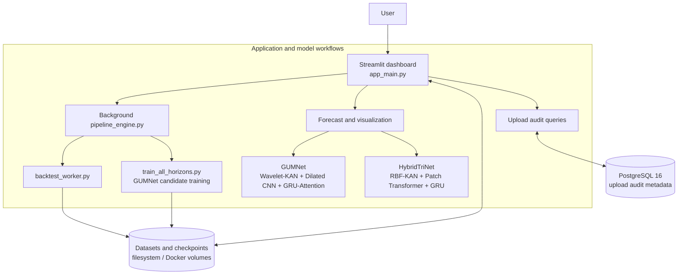
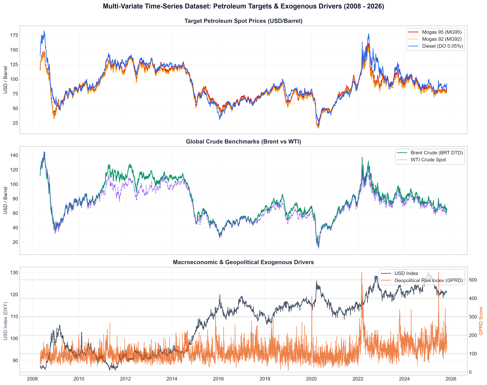
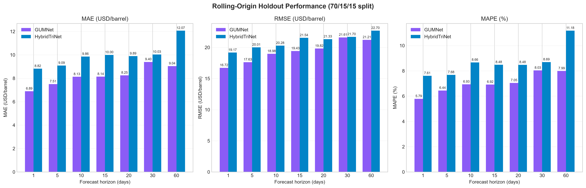
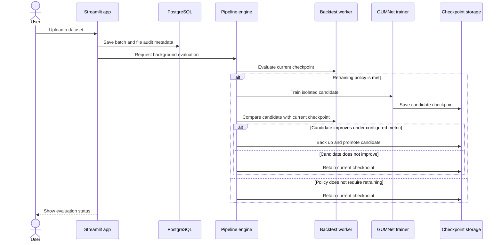

# Crude Oil Multi-Horizon Forecasting Platform

A Streamlit application for exploring crude-oil and petroleum-product time series and generating forecasts at 1, 5, 10, 15, 20, 30, and 60-day horizons. The repository includes two PyTorch forecasting models, an automated GUMNet candidate-evaluation workflow, and PostgreSQL-backed upload audit history.

> **Research status:** Holdout metrics below come from one chronological rolling-origin evaluation. They are a reproducible project benchmark, not a guarantee of future performance or evidence that either model is production-ready.

## Capabilities

- Load petroleum-market datasets and generate multi-horizon forecasts with GUMNet or HybridTriNet.
- Review forecasts, backtest metrics, visual comparisons, and upload audit records in a Streamlit dashboard.
- Evaluate a GUMNet candidate in a background workflow and promote it only when it improves on the current checkpoint under the configured backtest policy.
- Store upload-batch and per-file audit metadata in PostgreSQL; keep datasets and model checkpoints on the filesystem or mounted Docker volumes.

## System Architecture



## Model Architectures

### GUMNet

GUMNet produces quantile forecasts at the configured horizons. Its branches combine:

- A Wavelet-KAN block using a Mexican Hat wavelet basis.
- A dilated 1D convolution branch for local temporal patterns.
- A two-layer GRU with multi-head attention.
- A learned softmax gate to fuse branch representations.
- Quantile outputs for `q = 0.1`, `0.5`, and `0.9`.

The quantile outputs are forecasts at specified quantiles; they should not be described as calibrated prediction intervals without a separate calibration evaluation.

<p align="center">
  
</p>

### HybridTriNet

HybridTriNet combines an RBF-KAN branch, a patch-based Transformer Encoder implemented with PyTorch, and a GRU branch. A learned gating layer fuses branch representations for multi-horizon prediction.

<p align="center">
  
</p>

## Data

The processed training series used for the benchmark is `oil_forecast_research_new-main/data/processed/clean_data_exo_ver1.csv`. It contains petroleum-product target series and market or macroeconomic features, including Brent, WTI, USD Index, and GPRD. The plot below visualizes the dataset used by the project documentation.

<p align="center">
  
</p>

## Training and Holdout Evaluation

The comparison uses a chronological 70% / 15% / 15% train, validation, and holdout split based on target timestamps. Scalers are fitted using training rows only. Forecast target windows are kept within their assigned partition; validation and holdout inputs may include earlier observations, as they would in rolling-origin forecasting.

GUMNet is trained with quantile (pinball) loss, while HybridTriNet uses Smooth L1 loss. Those training losses have different objectives and are not directly comparable. The reported metrics are computed after inverse scaling in USD per barrel: GUMNet's median (`q=0.5`) forecast is compared with HybridTriNet point forecasts using MAE, RMSE, and MAPE.

### Latest recorded benchmark

The evaluated holdout period is **2023-09-11 to 2026-05-25**. Metrics are pooled across four target series and rolling forecast origins. The table shows the unweighted mean of each metric across the seven forecast horizons.

| Model | Mean MAE (USD/barrel) | Mean RMSE (USD/barrel) | Mean MAPE |
|---|---:|---:|---:|
| GUMNet, median quantile | 8.195 | 19.342 | 7.022% |
| HybridTriNet | 9.966 | 20.962 | 8.685% |

In this evaluation, GUMNet has lower mean error on all three metrics. This single holdout result does not establish that it will outperform HybridTriNet on other periods or data distributions. Use rolling-origin cross-validation and monitor performance on new observations before making broader claims.

<p align="center">
  
</p>

### Reproduce the benchmark

Run from the repository root. The command writes benchmark checkpoints and metrics under `benchmark/clean_run/`, separate from the application's `checkpoints_multi/` directory:

```powershell
python train_all_horizons.py --models GUMNet HybridTriNet --horizons 1 5 10 15 20 30 60 --force_retrain --output_dir benchmark/clean_run
python docs/generate_data_and_training_plots.py
```

The results are recorded in `benchmark/clean_run/holdout_metrics.csv`. Training all model and horizon combinations can take a while; use the same data, configuration, and code revision when reproducing a comparison.

## Background GUMNet Candidate Workflow

The application's background pipeline evaluates whether new observations warrant training a GUMNet candidate. The configured trigger conditions and backtest policy are implemented in `pipeline_engine.py`; they can be adjusted there as the project evolves.



## Database and Deployment

PostgreSQL stores upload audit metadata, not the time-series datasets or model weights:

- `ingestion_batches` stores upload-batch records.
- `ingestion_files` stores per-file status and metadata, including `details_json` as JSONB.
- Dataset files and PyTorch checkpoints remain in filesystem directories mounted into the app container.

### Run with Docker Compose

Requirements: Docker Desktop with Docker Compose.

1. Create a local environment file:

   ```powershell
   Copy-Item .env.example .env
   ```

2. Set a private `POSTGRES_PASSWORD` in `.env`, then build and start the database and app:

   ```powershell
   docker compose up -d --build app
   ```

   Compose starts PostgreSQL and waits for its health check before starting the app. The optional `train` service is a separate CPU training job; it is not started by this command.

3. Open [http://localhost:8502](http://localhost:8502).

To stop the app and database:

```powershell
docker compose down
```

The database uses the named `postgres_data` volume. Back it up before removing volumes or changing database configuration.

## Streamlit Dashboard

The dashboard includes forecasting, backtest metrics, visual comparisons, upload history, and detailed result views.

<p align="center">
  
</p>

<p align="center">
  
</p>

<p align="center">
  
</p>

<p align="center">
  
</p>

<p align="center">
  
</p>

## Repository Layout

```text
app_main.py                              # Streamlit application
pipeline_engine.py                       # Background candidate-evaluation workflow
backtest_worker.py                       # Backtesting utilities
train_all_horizons.py                    # Multi-model, multi-horizon training and evaluation
database.py                              # PostgreSQL audit-history access
oil_forecast_research_new-main/src/model/ # GUMNet and data-processing code
Hybridtrinet_Oil/src/                    # HybridTriNet model code
datasets/                                # Local datasets (not necessarily tracked by Git)
checkpoints_multi/                       # Application checkpoints (not necessarily tracked by Git)
docs/images/                             # Architecture, dataset, dashboard, and metric figures
benchmark/clean_run/                     # Isolated benchmark outputs and checkpoints
Dockerfile
docker-compose.yml
requirements.txt
```

## Limitations

- The reported comparison is based on one holdout period and rolling forecast origins; performance can change across market regimes.
- The headline metrics average across forecast horizons and target series, which can hide differences for individual products or horizons. Inspect `holdout_metrics.csv` for the detailed results.
- GUMNet quantile forecasts have not been presented as calibrated uncertainty intervals.
- Docker Compose configures the application and PostgreSQL. Model training and inference inside the container use CPU by default; GPU deployment requires a separately configured runtime.
