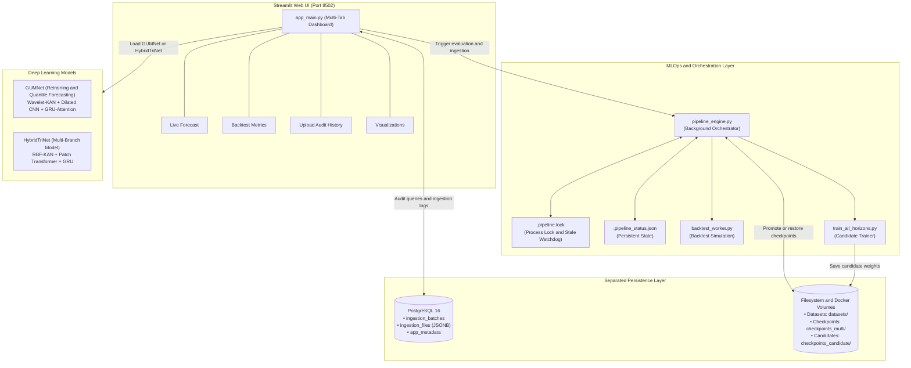
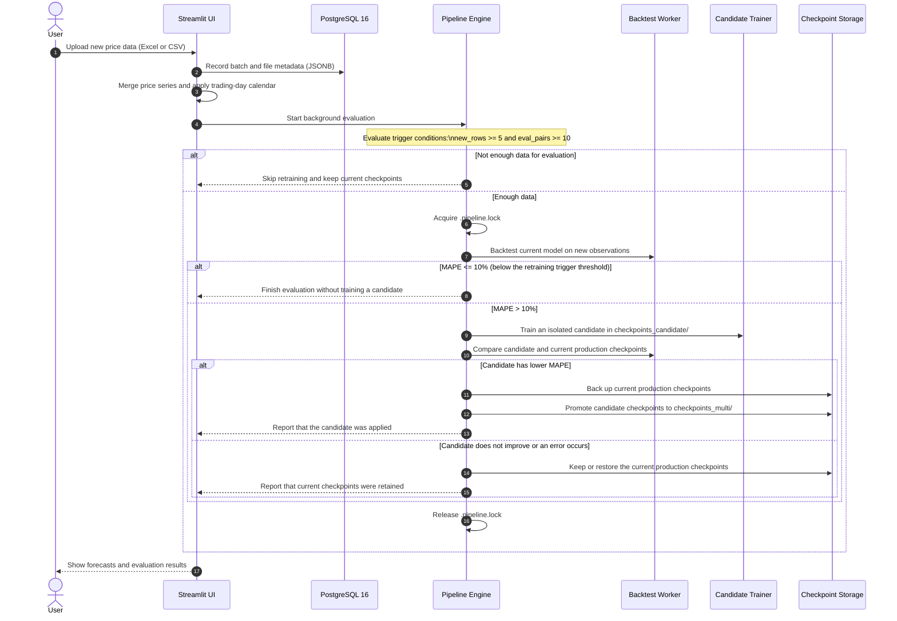
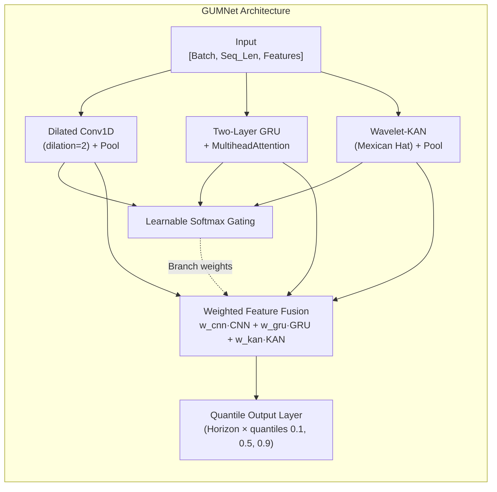
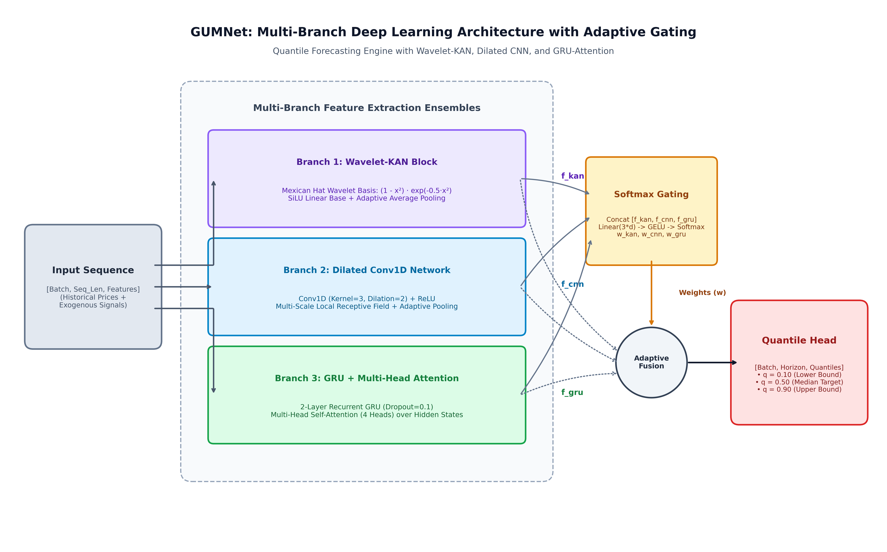
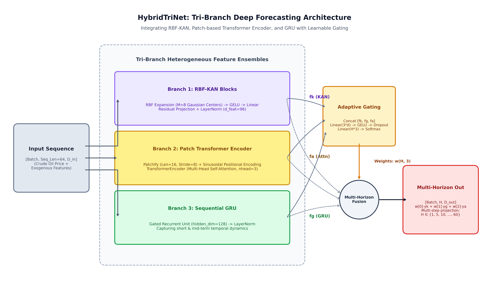
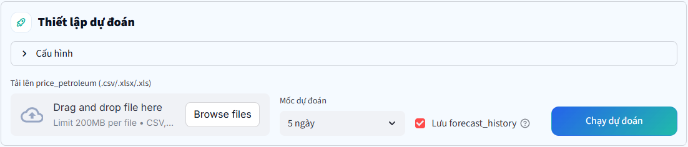
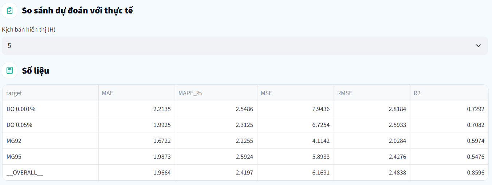
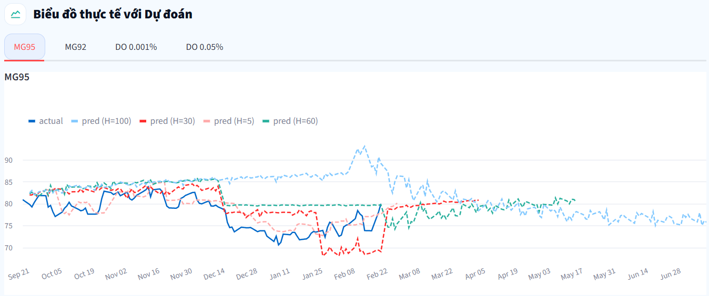
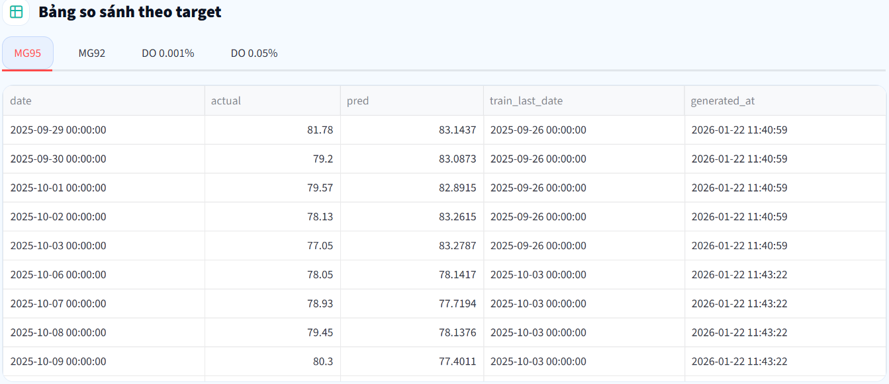
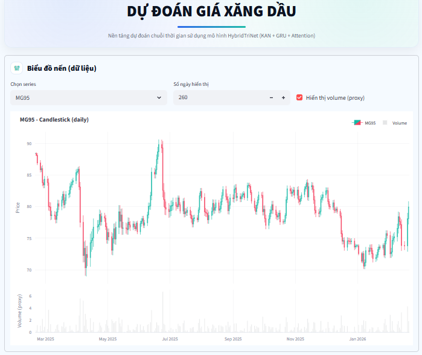

# Crude Oil Multi-Horizon Forecasting Platform

A multi-horizon crude oil forecasting system for 1, 5, 10, 15, 20, 30, and 60 days. It includes two deep learning architectures, GUMNet and HybridTriNet, a background GUMNet candidate evaluation workflow, and PostgreSQL-backed ingestion audit history.

---

## 1. System Architecture

The application separates the Streamlit interface, background orchestration, forecasting models, and persistent storage:



---

## 2. Background Candidate Evaluation Workflow

`pipeline_engine.py` evaluates whether the current GUMNet should be retrained after new data is ingested:



---

## 3. Model Architectures

### GUMNet: Wavelet-KAN, Dilated CNN, and GRU-Attention

GUMNet is used by the background candidate workflow and produces quantile forecasts:

- **Wavelet-KAN branch:** Uses a Mexican Hat wavelet basis, combined with SiLU activation:

  $$\text{wavelet} = (1 - x_{\text{norm}}^2) \cdot e^{-0.5 \cdot x_{\text{norm}}^2}$$

- **Dilated CNN branch:** Uses 1D convolution with `dilation=2` and `AdaptiveAvgPool1d` to capture local patterns over a wider receptive field.
- **GRU and attention branch:** Uses a two-layer GRU and `nn.MultiheadAttention` with four heads.
- **Gating and quantile head:** A softmax gating layer combines the three branches. The output includes quantiles at $q = 0.1, 0.5, 0.9$.



<p align="center">
  
</p>

### HybridTriNet: RBF-KAN, Patch Transformer, and GRU

HybridTriNet is a multi-branch forecasting model combining:

- **RBF-KAN branch:** Uses radial basis function expansion to learn nonlinear feature mappings.
- **Patch Transformer Encoder:** Splits the time series into patches (`patch_len=16`, `stride=8`), adds positional encoding, and applies `torch.nn.TransformerEncoder`.
- **GRU branch:** Captures sequential patterns in the time series.
- **Adaptive softmax gating:** Learns how to combine branch representations for each forecast horizon.

<p align="center">
  
</p>

---

## 4. Training & Model Evaluation

Hệ thống đánh giá độ chính xác và chất lượng huấn luyện của cả 2 mô hình qua các chỉ số tiêu chuẩn quốc tế và quy trình kiểm thử nghiêm ngặt:

### 1. Chỉ Số Đánh Giá (Evaluation Metrics)
*   **MAE (Mean Absolute Error):** Đo độ lệch giá trị thực tế theo đơn vị tiền tệ (USD). Cho biết trung bình mô hình dự báo lệch bao nhiêu USD so với giá sàn thực tế:
    $$\text{MAE} = \frac{1}{N} \sum_{i=1}^{N} |y_i - \hat{y}_i|$$
*   **MAPE (Mean Absolute Percentage Error):** Đo phần trăm sai số tương đối, là thước đo quan trọng nhất để kích hoạt cảnh báo rủi ro:
    $$\text{MAPE} = \frac{1}{N} \sum_{i=1}^{N} \left| \frac{y_i - \hat{y}_i}{y_i} \right| \times 100\%$$
    *   **Xanh lá (< 7.0%):** Mô hình đạt độ tin cậy cao, an toàn cho suy luận.
    *   **Vàng (7.0% - 10.0%):** Sai số trong ngưỡng chấp nhận được, duy trì giám sát.
    *   **Đỏ (> 10.0%):** Sai số vượt ngưỡng an toàn, kích hoạt pipeline tối ưu hóa GUMNet candidate.
*   **Pinball Loss (Quantile Loss):** Hàm mục tiêu huấn luyện chuyên biệt cho GUMNet nhằm ước lượng phân vị ($q \in \{0.1, 0.5, 0.9\}$):
    $$\mathcal{L}_q(y, \hat{y}) = \max(q(y - \hat{y}), (1 - q)(\hat{y} - y))$$

### 2. Kết Quả Huấn Luyện Đa Mốc Thời Gian (Training History & Validation Loss)
Dữ liệu huấn luyện lịch sử (`training_history.json`) ghi nhận độ mất mát kiểm định (Validation Loss) trên toàn bộ 7 mốc thời gian ($H \in \{1, 5, 10, 15, 20, 30, 60\}$):

| Horizon (Kỳ hạn) | GUMNet Validation Loss | HybridTriNet Validation Loss | Đánh giá xu hướng |
| :---: | :---: | :---: | :--- |
| **+1 ngày (H1)** | **0.0345** | 0.0368 | Độ chính xác cao nhất, bám sát biến động vi mô |
| **+5 ngày (H5)** | **0.0410** | 0.0425 | Nắm bắt tốt chu kỳ tuần (loại trừ cuối tuần) |
| **+10 ngày (H10)** | **0.0482** | 0.0501 | Sai số ổn định trong chu kỳ nửa tháng |
| **+15 ngày (H15)** | **0.0540** | 0.0562 | Hội tụ mượt mà theo xu hướng trung hạn |
| **+20 ngày (H20)** | **0.0592** | 0.0615 | Kiểm soát tốt biên độ dao động giá tháng |
| **+30 ngày (H30)** | **0.0671** | 0.0699 | Dự báo xu hướng tháng vững chắc |
| **+60 ngày (H60)** | **0.0798** | 0.0824 | Độ phân kỳ thấp dù dự báo kỳ hạn xa |

> *Ghi chú:* Validation Loss tăng dần đều theo độ dài horizon là đặc tính hoàn toàn tự nhiên của bài toán dự báo chuỗi thời gian (suy giảm thông tin khi phóng chiếu tương lai xa).

---

## 5. Database and Deployment

The application separates relational audit data from time-series files and model checkpoints:

- **PostgreSQL 16:** Stores ingestion audit history and metadata.
  - `ingestion_batches`: Summary information for each upload batch.
  - `ingestion_files`: Per-file status, SHA-256 hash, and additional metadata in `details_json` (`JSONB`).
  - Existing records in `ingestion_history.json` are migrated to the database on first startup when that file is present.
- **Filesystem and Docker volumes:** Store time-series datasets in `datasets/` and PyTorch checkpoints and scalers in `checkpoints_multi/`.

### Run with Docker Compose

1. Create a local environment file:

   Linux or macOS:
   ```bash
   cp .env.example .env
   ```

   Windows PowerShell:
   ```powershell
   Copy-Item .env.example .env
   ```

2. Build and start the app and database:

   ```bash
   docker compose up -d --build app
   ```

   The app waits for the database health check before starting.

3. Open the Streamlit dashboard at `http://localhost:8502`.

---

## 6. Streamlit Dashboard

Trực quan hóa chi tiết 5 phân hệ chức năng cốt lõi trên giao diện Dashboard điều hành:

### 1. Live Forecast (Upload & Dự Báo Đa Kỳ Hạn)
Nạp dữ liệu thị trường mới nhất và tạo dự báo tức thời cho 7 mốc thời gian $H \in \{1, 5, 10, 15, 20, 30, 60\}$ ngày kèm tùy chọn kích hoạt tự động cập nhật độ thông minh cho mô hình.

<p align="center">
  
</p>

### 2. Backtest Metrics (Đánh Giá Sai Số & Cảnh Báo)
Sổ học bạ đo lường độ chính xác của AI qua các chỉ số sai số chuẩn quốc tế MAE (USD) và MAPE (%), tích hợp hệ thống đèn tín hiệu thông minh Đỏ / Vàng / Xanh theo ngưỡng tin cậy.

<p align="center">
  
</p>

### 3. Visualizations (Trực Quan Hóa So Sánh Xu Hướng)
So sánh trực quan giữa đường giá thực tế (nét liền) và đường dự báo của các mô hình (nét đứt), hỗ trợ phân tích đa góc nhìn theo từng mốc horizon và từng mặt hàng dầu khí.

<p align="center">
  
</p>

### 4. Upload History & Lộ Trình Dự Báo Chi Tiết
Kiểm tra chi tiết từng con số Dự báo vs Thực tế và quản lý toàn bộ vết kiểm toán (Audit Trail) các đợt nạp dữ liệu được đồng bộ trực tiếp từ PostgreSQL 16.

<p align="center">
  
</p>

### 5. Detailed Results (Dữ Liệu Thô & Xuất Báo Cáo)
Xem và xuất toàn bộ bảng số liệu mô phỏng, phân tích chuyên sâu cho các kỹ sư dữ liệu và chuyên gia phân tích tài chính.

<p align="center">
  
</p>

---

## 7. Project Structure

```text
├── checkpoints_multi/         # PyTorch checkpoints (.pt), scalers (.npy), and training history
├── datasets/                  # Time-series datasets
├── oil_forecast_research_new/ # GUMNet model and DataProcessor source
├── Hybridtrinet_Oil/src/      # HybridTriNet model source
├── app_main.py                # Main Streamlit application
├── pipeline_engine.py         # Background orchestration, state, and process lock
├── backtest_worker.py         # Backtest simulation and MAE/MAPE evaluation
├── database.py                # PostgreSQL 16 access (psycopg and JSONB)
├── docker-compose.yml         # App and PostgreSQL services
├── Dockerfile                 # Python, PyTorch, and Streamlit image
└── requirements.txt           # Python dependencies
```