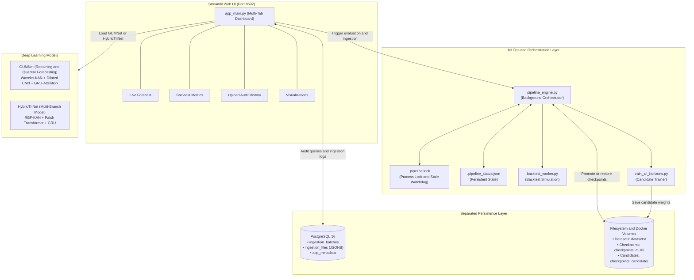
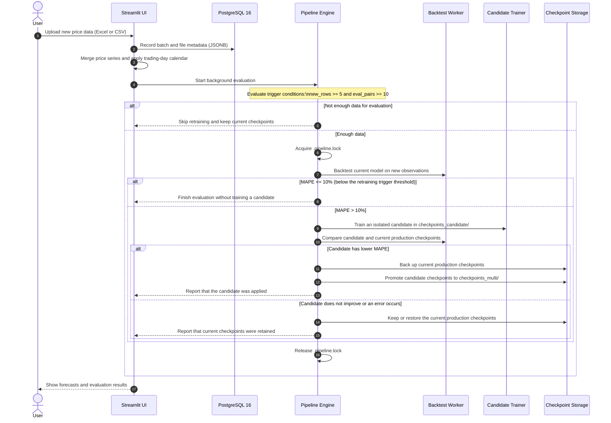
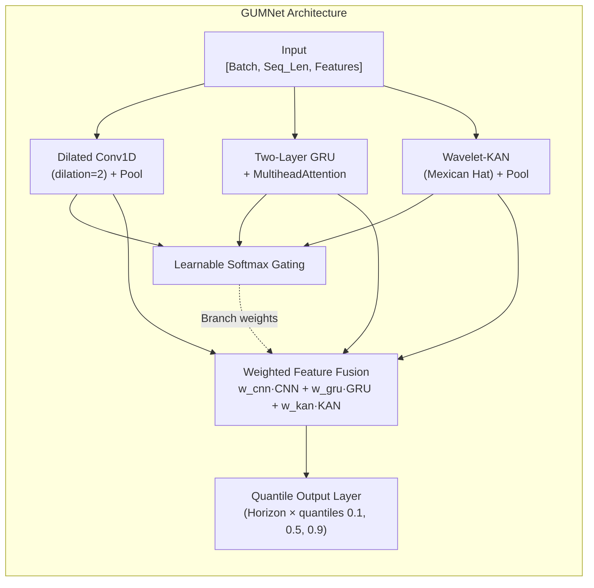

# Crude Oil Multi-Horizon Forecasting Platform

A multi-horizon crude oil forecasting system for 1, 5, 10, 15, 20, 30, and 60 days. It includes two deep learning architectures, GUMNet and HybridTriNet, a background GUMNet candidate evaluation workflow, and PostgreSQL-backed ingestion audit history.

---

## 1. System Architecture

The application separates the Streamlit interface, background orchestration, forecasting models, and persistent storage:



---

## 2. Background Candidate Evaluation Workflow

`pipeline_engine.py` evaluates whether the current GUMNet should be retrained after new data is ingested:



---

## 3. Model Architectures

### GUMNet: Wavelet-KAN, Dilated CNN, and GRU-Attention

GUMNet is used by the background candidate workflow and produces quantile forecasts:

- **Wavelet-KAN branch:** Uses a Mexican Hat wavelet basis, combined with SiLU activation:

  $$\text{wavelet} = (1 - x_{\text{norm}}^2) \cdot e^{-0.5 \cdot x_{\text{norm}}^2}$$

- **Dilated CNN branch:** Uses 1D convolution with `dilation=2` and `AdaptiveAvgPool1d` to capture local patterns over a wider receptive field.
- **GRU and attention branch:** Uses a two-layer GRU and `nn.MultiheadAttention` with four heads.
- **Gating and quantile head:** A softmax gating layer combines the three branches. The output includes quantiles at $q = 0.1, 0.5, 0.9$.



<p align="center">
  
</p>

### HybridTriNet: RBF-KAN, Patch Transformer, and GRU

HybridTriNet is a multi-branch forecasting model combining:

- **RBF-KAN branch:** Uses radial basis function expansion to learn nonlinear feature mappings.
- **Patch Transformer Encoder:** Splits the time series into patches (`patch_len=16`, `stride=8`), adds positional encoding, and applies `torch.nn.TransformerEncoder`.
- **GRU branch:** Captures sequential patterns in the time series.
- **Adaptive softmax gating:** Learns how to combine branch representations for each forecast horizon.

<p align="center">
  
</p>

---

## 4. Database and Deployment

The application separates relational audit data from time-series files and model checkpoints:

- **PostgreSQL 16:** Stores ingestion audit history and metadata.
  - `ingestion_batches`: Summary information for each upload batch.
  - `ingestion_files`: Per-file status, SHA-256 hash, and additional metadata in `details_json` (`JSONB`).
  - Existing records in `ingestion_history.json` are migrated to the database on first startup when that file is present.
- **Filesystem and Docker volumes:** Store time-series datasets in `datasets/` and PyTorch checkpoints and scalers in `checkpoints_multi/`.

### Run with Docker Compose

1. Create a local environment file:

   Linux or macOS:
   ```bash
   cp .env.example .env
   ```

   Windows PowerShell:
   ```powershell
   Copy-Item .env.example .env
   ```

2. Build and start the app and database:

   ```bash
   docker compose up -d --build app
   ```

   The app waits for the database health check before starting.

3. Open the Streamlit dashboard at `http://localhost:8502`.

---

## 5. Streamlit Dashboard

1. **Live Forecast:** Upload data and view forecasts for horizons $H \in \{1, 5, 10, 15, 20, 30, 60\}$ days.
2. **Backtest Metrics:** Review MAE, MAPE, and error-threshold indicators.
3. **Upload History:** Review ingestion audit records stored in PostgreSQL.
4. **Visualizations:** Compare forecast trends with observed prices.
5. **Detailed Results:** Inspect and export evaluation data.

---

## 6. Project Structure

```text
├── checkpoints_multi/         # PyTorch checkpoints (.pt), scalers (.npy), and training history
├── datasets/                  # Time-series datasets
├── oil_forecast_research_new/ # GUMNet model and DataProcessor source
├── Hybridtrinet_Oil/src/      # HybridTriNet model source
├── app_main.py                # Main Streamlit application
├── pipeline_engine.py         # Background orchestration, state, and process lock
├── backtest_worker.py         # Backtest simulation and MAE/MAPE evaluation
├── database.py                # PostgreSQL 16 access (psycopg and JSONB)
├── docker-compose.yml         # App and PostgreSQL services
├── Dockerfile                 # Python, PyTorch, and Streamlit image
└── requirements.txt           # Python dependencies
```