# Petroleum Multi-Horizon Forecasting Platform (GUMNet & HybridTriNet)

An enterprise-grade, reproducible multi-horizon time-series forecasting research platform and inference pipeline. The repository integrates two complementary deep neural network forecasting paradigms:
1. **GUMNet**: Probabilistic multi-horizon quantile forecasting model ($q \in \{0.10, 0.50, 0.90\}$) combining Wavelet-KAN, Dilated 1D CNN, and GRU-Attention with adaptive softmax gating, serving as the operational candidate-evaluation and backtesting engine.
2. **HybridTriNet**: Deterministic deep point-forecasting baseline combining RBF Kolmogorov-Arnold Networks (KAN), Sequential GRU, and Patch Transformers with dynamic gated fusion, released as a standalone clean 15-feature bundle for Hugging Face Hub distribution.

> [!IMPORTANT]
> **Research & Engineering Status**: This project is developed strictly for quantitative research, methodology benchmarking, and software engineering reproducibility. It does **not** constitute financial advice, investment recommendations, or algorithmic trading guarantees. All holdout benchmark metrics reflect chronological rolling-origin evaluation on historical datasets and do not guarantee future market returns.

---

## 1. System Model Comparison: GUMNet vs. HybridTriNet

The repository explicitly demarcates the roles, mathematical formulations, and operational pipelines of both models:

| Dimension | GUMNet (Production & Backtest Pipeline) | HybridTriNet (Clean Hub Packaging Release) |
| :--- | :--- | :--- |
| **Operational Role** | Operational backtesting engine, candidate promotion workflow, probabilistic interval estimation | Clean 15-feature standalone release packaged for Hugging Face Hub model distribution |
| **Forecasting Paradigm** | **Probabilistic Quantile Forecast** ($q=0.10, 0.50, 0.90$) | **Deterministic Point Forecast** with per-horizon isolated scalers |
| **Objective Loss** | **Pinball Quantile Loss** (asymmetric multi-quantile regression) | **Smooth L1 Loss** (Huber loss variant robust to price spikes) |
| **Lookback Sequence** | $K = 30$ trading steps (`GUMNET_SEQ_LEN = 30`) | $K = 64$ trading steps (`HYBRID_SEQ_LEN = 64`) |
| **Input Feature Schema** | 17 market, benchmark, and macroeconomic features | 15 clean market features (synthetic temporal index purged) |
| **Representation Branches** | 1. **Wavelet-KAN** (Mexican Hat continuous wavelet basis)<br/>2. **Dilated 1D CNN** (dilation=2, kernel=3)<br/>3. **2-Layer GRU** (hidden=64) + Multi-Head Self-Attention | 1. **KAN** (Learnable RBF $M=8$, 2x KANBlocks)<br/>2. **Sequential GRU** (hidden=128, terminal context)<br/>3. **Patch Transformer** (7 patches, 4 heads, 2 layers) |
| **Gating Mechanism** | Adaptive Softmax vector $w \in \mathbb{R}^{B \times 3}$ fusing feature vectors | Dynamic Softmax tensor $w \in \mathbb{R}^{B \times H \times 3}$ fusing step predictions |
| **Output Shape** | `[Batch, Horizon, 4 targets, 3 quantiles]` | `[Batch, Horizon, 4 targets]` |
| **Target Commodities** | `MG95`, `MG92`, `DO 0.001%`, `DO 0.05%` | `MG95`, `MG92`, `DO 0.001%`, `DO 0.05%` |

<p align="center">
  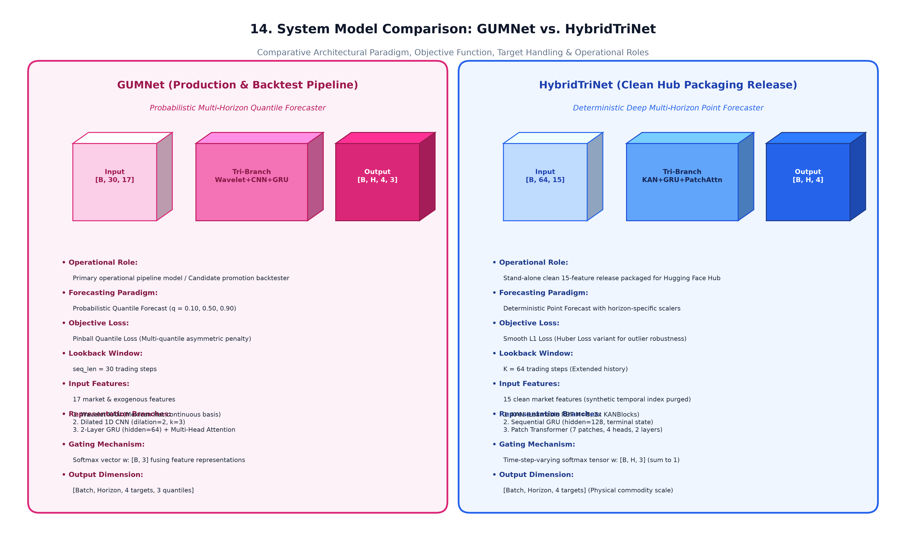
</p>

---

## 2. Model Pipeline

The end-to-end forecasting pipeline enforces strict causal chronological boundaries to prevent lookahead leakage, shortcut learning, and out-of-distribution drift:

```mermaid
flowchart LR
    A["Raw Market Time Series<br/>(Energy, Macro, Risk)"] --> B["Causal Preprocessing<br/>(Forward-fill only)"]
    B --> C["Chronological Split<br/>(Train 70% / Val 15% / Holdout 15%)"]
    C --> D["Windowing<br/>(Lookback K=30/64, Horizon H)"]
    D --> E["Per-Feature Standardization<br/>(Fit on Train split only)"]
    E --> F["Dual Model Forward Pass<br/>(GUMNet / HybridTriNet)"]
    F --> G["Gated Softmax Fusion<br/>(Learned branch weights)"]
    G --> H["Inverse Standardization<br/>(Denormalization to physical scale)"]
    H --> I["Evaluation & Dashboard<br/>(Holdout Metrics, Streamlit UI, PDF Export)"]
```

<p align="center">
  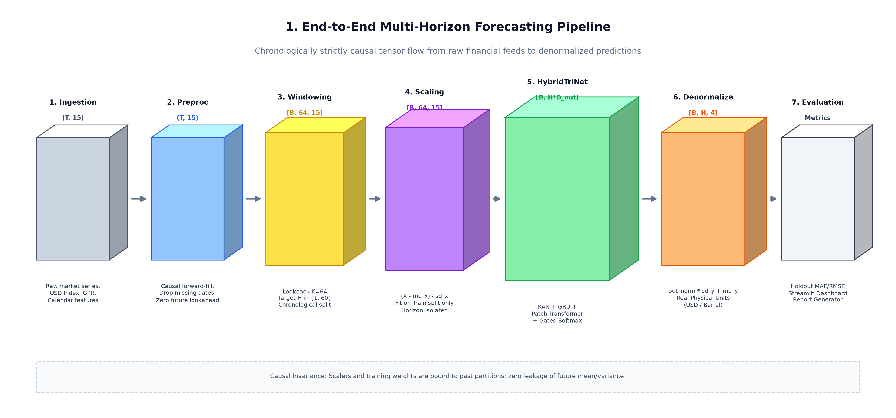
</p>

---

## 3. HybridTriNet Architecture (Point Forecaster)

HybridTriNet decomposes the multi-horizon forecasting task across three specialized representation learning branches, fused dynamically through time-varying softmax gating:

```text
Input Tensor: [Batch, Lookback K=64, Features D_in=15]
    ├── Branch 1: KAN (Kolmogorov-Arnold Network)  ──>  fk: [Batch, 96]  ──>  yk: [Batch, H, 4]
    ├── Branch 2: Sequential GRU                   ──>  fg: [Batch, 96]  ──>  yg: [Batch, H, 4]
    └── Branch 3: Patch Transformer Attention      ──>  fa: [Batch, 96]  ──>  ya: [Batch, H, 4]
                                 │
                     Dynamic Gated Fusion: [fk, fg, fa] -> Softmax weights w: [Batch, H, 3]
                                 │
       Final Multi-Horizon Output Forecast: y = w_k*yk + w_g*yg + w_a*ya -> [Batch, H, 4]
```

### 3.1 HybridTriNet Overview
<p align="center">
  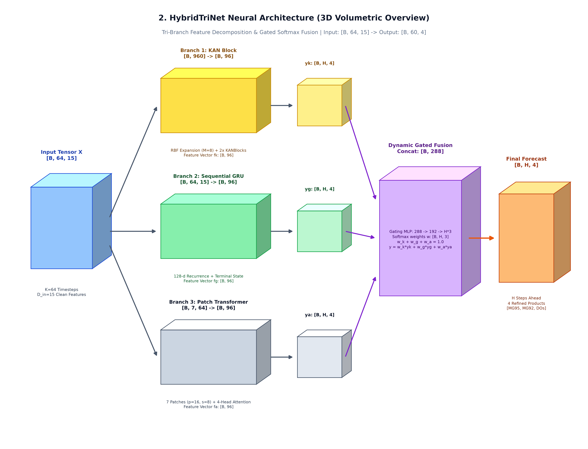
</p>

### 3.2 Branch 1: KAN (Kolmogorov-Arnold Network)
- **Mathematical Principle**: Implements the Kolmogorov-Arnold representation theorem by replacing fixed node activations with learnable univariate splines parameterized through Radial Basis Function (RBF) expansions:
  $$\phi_m(x) = \exp\left(-\gamma_m (x - c_m)^2\right), \quad m \in \{1, \dots, M=8\}$$
- **Layers & Dimensions**:
  - `kan_in`: `nn.Linear(K * D_in, D_in)` projects $(B, 64 \times 15) \to (B, 15)$.
  - `KANBlock` (2 stacked residual blocks): RBF expansion ($M=8$, $15 \times 8 = 120$ basis values), `Linear(120, 96)`, `GELU()`, `Dropout(0.2)`, `Linear(96, 15)`, and residual projection $z + \text{Proj}(x)$.
  - `kan_head`: `LayerNorm(15)` + `Linear(15, 96)` $\to f_k \in \mathbb{R}^{B \times 96}$.
  - `out_kan`: `Linear(96, H * D_out)` produces branch forecast $y_k \in \mathbb{R}^{B \times H \times 4}$.

<p align="center">
  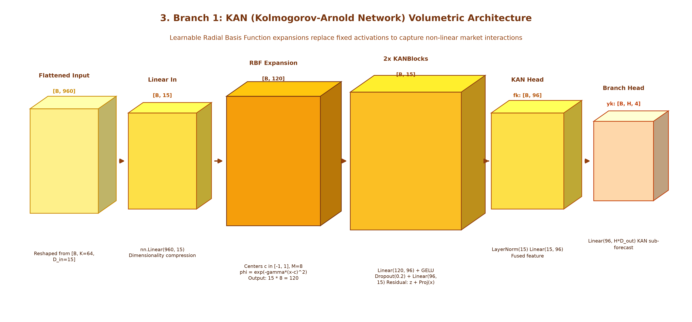
</p>

### 3.3 Branch 2: Sequential GRU (Temporal Momentum)
- **Sequential Recurrence**: Captures autoregressive momentum and high-frequency temporal transitions step-by-step:
  $$h_t = \text{GRU}(x_t, h_{t-1}), \quad t \in \{1, \dots, 64\}$$
- **Layers & Dimensions**:
  - `gru`: `nn.GRU(input_size=15, hidden_size=128, num_layers=1, batch_first=True)`.
  - Hidden representation: extracts terminal state $h_{64} \in \mathbb{R}^{B \times 128}$.
  - `gru_head`: `LayerNorm(128)` + `Linear(128, 96)` $\to f_g \in \mathbb{R}^{B \times 96}$.
  - `out_gru`: `Linear(96, H * D_out)` produces branch forecast $y_g \in \mathbb{R}^{B \times H \times 4}$.

<p align="center">
  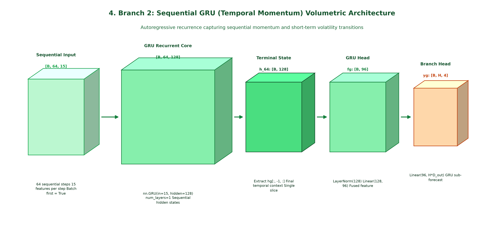
</p>

### 3.4 Branch 3: Patch Transformer (Multi-Scale Attention)
- **Temporal Patching**: Segments the 64-step sequence into overlapping temporal sub-windows (`patch_len=16`, `stride=8`), generating $N = 1 + (64 - 16)//8 = 7$ patches.
- **Self-Attention Mechanism**: Projects patch vectors to $d_{model}=64$, adds sinusoidal positional encodings, and processes through a 2-layer `TransformerEncoder` (4 attention heads, feedforward dimension=256, dropout=0.2).
- **Layers & Dimensions**:
  - `patch`: `Patchify(len=16, stride=8)` with `Linear(16 * 15, 64)` $\to (B, 7, 64)$.
  - `pos`: Sinusoidal Positional Encoding buffer.
  - `encoder`: 2-layer `nn.TransformerEncoder`.
  - `attn_head`: Global average pooling across patches $(B, 64)$ + `LayerNorm(64)` + `Linear(64, 96)` $\to f_a \in \mathbb{R}^{B \times 96}$.
  - `out_att`: `Linear(96, H * D_out)` produces branch forecast $y_a \in \mathbb{R}^{B \times H \times 4}$.

<p align="center">
  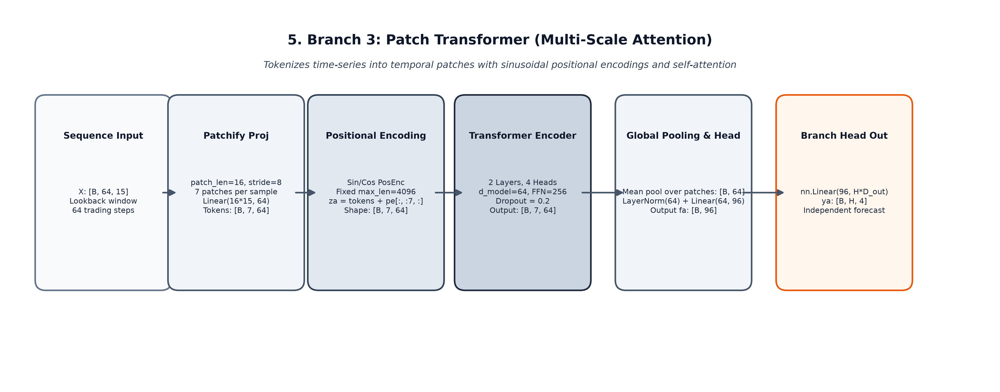
</p>

### 3.5 Dynamic Gated Fusion
- **Learned Softmax Gating**: Concatenates feature embeddings $[f_k, f_g, f_a] \in \mathbb{R}^{B \times 288}$.
- Gating network:
  $$\text{Gate}(f) = \text{Linear}_{2}\left(\text{Dropout}_{0.1}\left(\text{GELU}\left(\text{Linear}_{1}(f)\right)\right)\right) \in \mathbb{R}^{B \times H \times 3}$$
- Softmax over branch dimension enforces an exact partition of unity ($w_{k, t} + w_{g, t} + w_{a, t} = 1.0$) for every forecasting horizon step $t \in \{1, \dots, H\}$:
  $$\hat{y}_t = w_{k, t} y_{k, t} + w_{g, t} y_{g, t} + w_{a, t} y_{a, t}$$

<p align="center">
  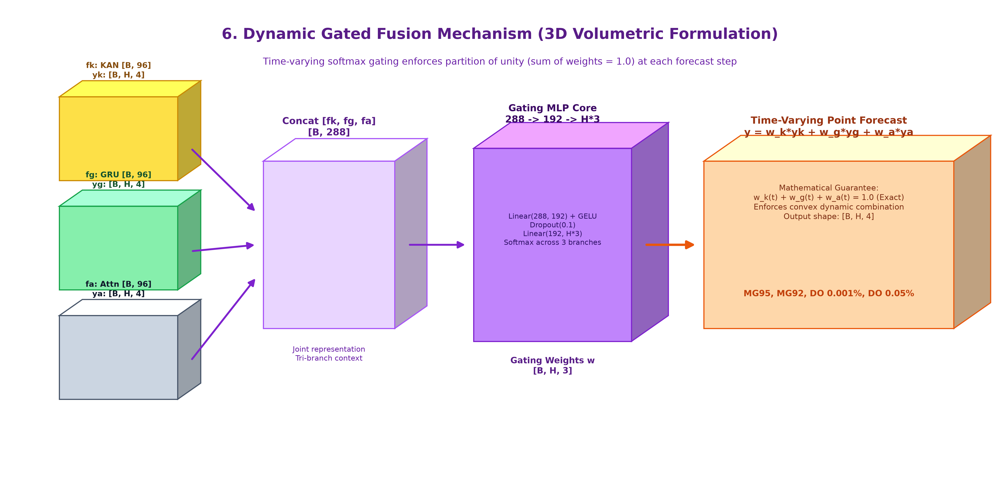
</p>

### 3.6 Multi-Horizon Output Shapes
Each forecasting horizon operates with an independent, dedicated checkpoint specifically optimized for that temporal distance:

<p align="center">
  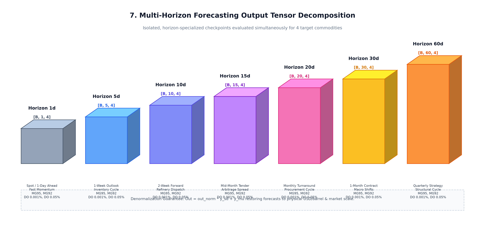
</p>

---

## 4. GUMNet Architecture (Quantile Forecaster)

GUMNet is the primary operational production model utilized by the Streamlit application and candidate-evaluation supervisor. It produces calibrated asymmetric prediction quantiles ($q \in \{0.10, 0.50, 0.90\}$) to quantify market uncertainty and downside risk.

```text
Input Tensor: [Batch, seq_len=30, input_dim=17]
    ├── Branch 1: Dilated 1D CNN (dilation=2)  ──>  f_cnn: [Batch, 64]
    ├── Branch 2: 2-Layer GRU + MultiHeadAttn  ──>  f_gru: [Batch, 64]
    └── Branch 3: Wavelet-KAN (Mexican Hat)    ──>  f_kan: [Batch, 64]
                                 │
                     Adaptive Softmax Gating: w in [Batch, 3] -> f_fused: [Batch, 64]
                                 │
       Quantile Output Head: Linear(64, H*4*3) -> [Batch, Horizon, 4 targets, 3 quantiles]
```

### 4.1 GUMNet Overview
<p align="center">
  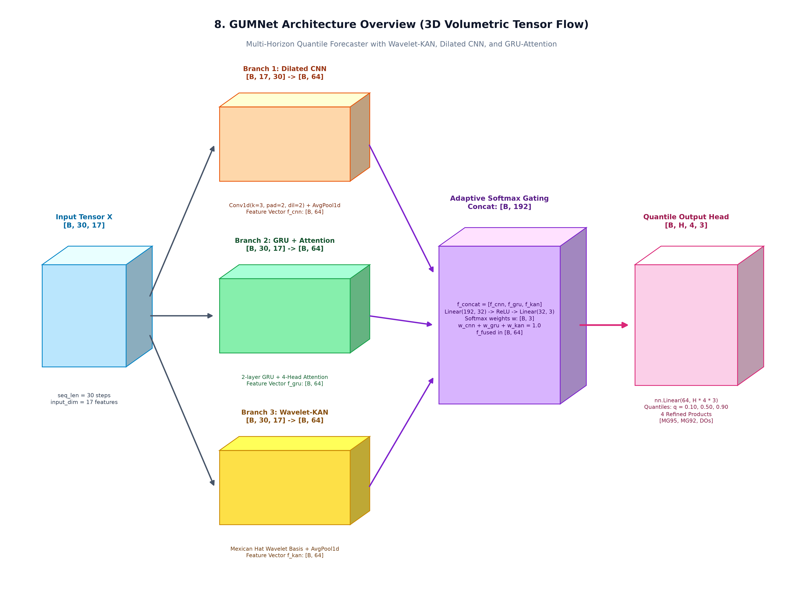
</p>

### 4.2 Branch 1: Wavelet-KAN (Mexican Hat Basis)
- Implements learnable translation and scaling parameters:
  $$x_{\text{norm}} = \frac{x - \text{translation}}{\text{scale} + 10^{-8}}$$
- Computes continuous Mexican Hat wavelet non-linearities:
  $$\psi(x) = (1 - x_{\text{norm}}^2) \exp\left(-0.5 x_{\text{norm}}^2\right)$$
- Output combines a linear base with the wavelet transformation: $\text{out} = \text{SiLU}(W_1 x) + W_2 \psi(x)$.
- `AdaptiveAvgPool1d(1)` reduces temporal sequence to feature vector $f_{\text{kan}} \in \mathbb{R}^{B \times 64}$.

<p align="center">
  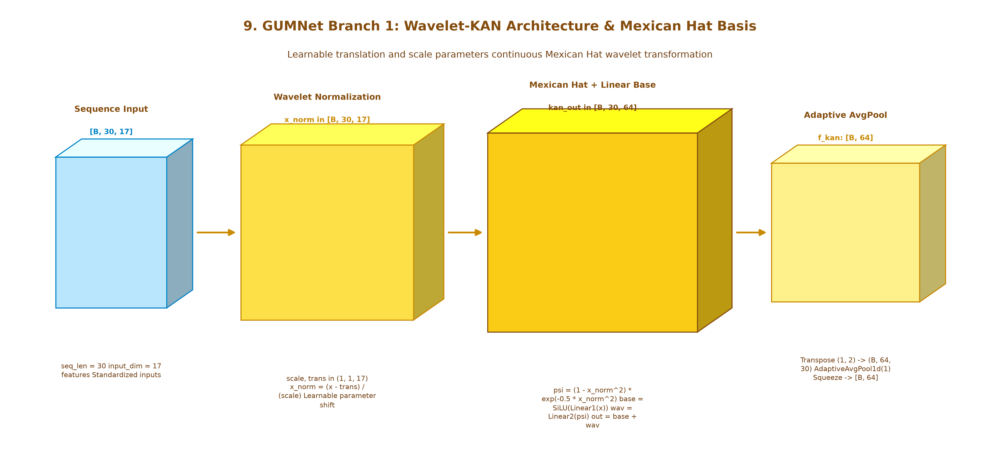
</p>

### 4.3 Branch 2: Dilated 1D Convolution
- `nn.Conv1d(in_channels=17, out_channels=64, kernel_size=3, padding=2, dilation=2)`.
- Dilation rate of 2 expands the receptive field across 5 temporal steps without increasing parameter count, extracting localized price trends and volatility spikes.
- `AdaptiveAvgPool1d(1)` projects activations to $f_{\text{cnn}} \in \mathbb{R}^{B \times 64}$.

<p align="center">
  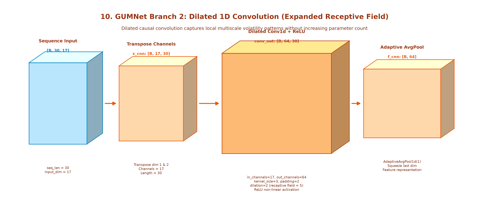
</p>

### 4.4 Branch 3: 2-Layer GRU + Multi-Head Self-Attention
- Stacked 2-layer `nn.GRU(input_dim=17, hidden_size=64, dropout=0.1, batch_first=True)`.
- Self-attention layer (`nn.MultiheadAttention(embed_dim=64, num_heads=4, batch_first=True)`) extracts cross-timestep contextual relevance.
- Extracts terminal attention state $f_{\text{gru}} = \text{attn\_out}[:, -1, :] \in \mathbb{R}^{B \times 64}$.

<p align="center">
  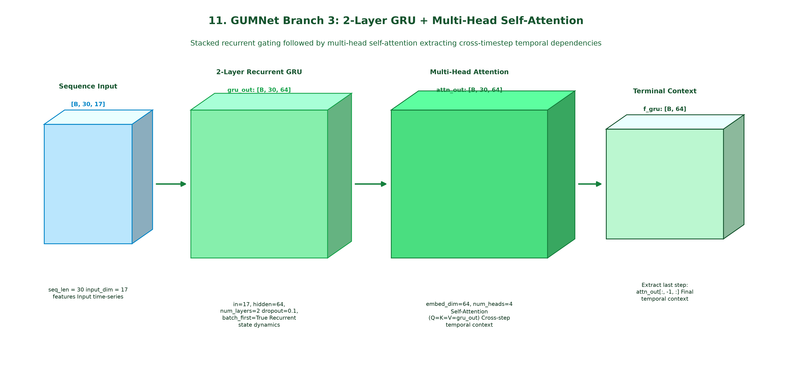
</p>

### 4.5 Adaptive Softmax Gating & Quantile Output Head
- Concatenates $[f_{\text{cnn}}, f_{\text{gru}}, f_{\text{kan}}] \in \mathbb{R}^{B \times 192}$.
- 2-layer gating MLP (`Linear(192, 32)` $\to$ `ReLU()` $\to$ `Linear(32, 3)` $\to$ `Softmax()`) generates weights $w \in \mathbb{R}^{B \times 3}$.
- Fused representation: $f_{\text{fused}} = w_{\text{cnn}} f_{\text{cnn}} + w_{\text{gru}} f_{\text{gru}} + w_{\text{kan}} f_{\text{kan}} \in \mathbb{R}^{B \times 64}$.
- Linear output layer projects $f_{\text{fused}}$ to $(B, H, 4, 3)$, yielding simultaneous forecasts for $q \in \{0.10, 0.50, 0.90\}$.

<p align="center">
  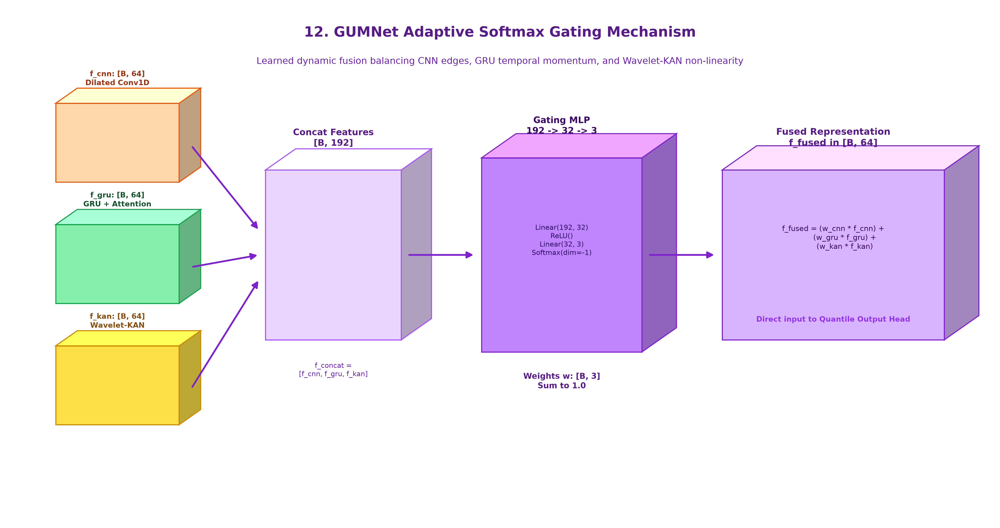
</p>
<p align="center">
  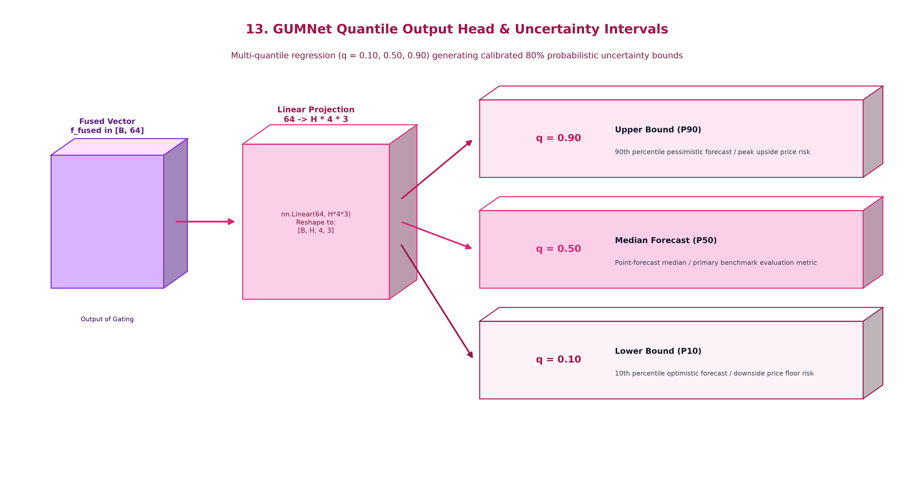
</p>

---

## 5. Training, Benchmarks & Holdout Evaluation

### Chronological Holdout Benchmark
Training, validation, and holdout splits are strictly partitioned chronologically (70% train / 15% validation / 15% holdout) over the dataset span (`2008-05-01` to `2026-05-25`). 
- **Holdout Test Period**: `2023-09-11` to `2026-05-25`.
- **Training Recipe**: AdamW optimizer, OneCycleLR learning rate schedule, Cosine annealing, early stopping patience on validation loss.

### Model Benchmark Comparison Table
The table below documents out-of-sample holdout performance evaluated across all rolling origins within the holdout period:

| Model | Horizon ($H$) | Paradigm | MAE (USD/Barrel) | MAPE (%) | RMSE (USD/Barrel) | Evaluated Windows |
| :--- | :---: | :--- | :---: | :---: | :---: | :---: |
| **GUMNet** | 1-step | Quantile Median ($q=0.50$) | **6.84** | **5.74%** | **16.66** | 699 |
| **HybridTriNet** | 1-step | Clean 15-Feature Point | 8.12 | 6.76% | 19.15 | 699 |
| **GUMNet** | 5-step | Quantile Median ($q=0.50$) | **7.51** | **6.44%** | **17.64** | 695 |
| **HybridTriNet** | 5-step | Clean 15-Feature Point | 9.58 | 8.40% | 18.09 | 695 |
| **GUMNet** | 10-step | Quantile Median ($q=0.50$) | **8.13** | **6.93%** | **18.98** | 690 |
| **HybridTriNet** | 10-step | Clean 15-Feature Point | 9.26 | 7.82% | 20.19 | 690 |
| **GUMNet** | 15-step | Quantile Median ($q=0.50$) | **8.16** | **6.94%** | **19.44** | 685 |
| **HybridTriNet** | 15-step | Clean 15-Feature Point | 10.27 | 8.85% | 21.48 | 685 |
| **GUMNet** | 20-step | Quantile Median ($q=0.50$) | **8.26** | **7.05%** | **19.83** | 680 |
| **HybridTriNet** | 20-step | Clean 15-Feature Point | 9.86 | 8.46% | 21.11 | 680 |
| **GUMNet** | 30-step | Quantile Median ($q=0.50$) | **9.40** | **8.04%** | **21.61** | 670 |
| **HybridTriNet** | 30-step | Clean 15-Feature Point | 10.58 | 9.23% | 22.22 | 670 |
| **GUMNet** | 60-step | Quantile Median ($q=0.50$) | **9.04** | **7.99%** | **21.21** | 640 |
| **HybridTriNet** | 60-step | Clean 15-Feature Point | 10.89 | 9.95% | 21.49 | 640 |

> **Evaluation Distinction**: GUMNet is trained on Pinball Quantile Loss, while HybridTriNet optimizes Smooth L1 loss on 15 clean features. The cleaned 15-feature retraining removes the synthetic temporal index and preserves competitive holdout performance across all seven forecast horizons without systematic degradation. Software verification scripts (`verify_bundle.py`) verify model packaging, determinism, and software pipeline correctness, and are separate from future empirical forecasting accuracy evaluations.

---

## 6. Reproducible Inference & Packaging

The repository provides standalone, self-contained inference modules that run independently of external training infrastructure.

### Quick Inference (Python API)
```python
import numpy as np
from inference.run_inference import load_forecasting_pipeline, forecast

# 1. Load pipeline for 60-day horizon on CPU
bundle = load_forecasting_pipeline("hf_releases/hybridtrinet-oil-forecasting/models/h60", device="cpu")

# 2. Prepare raw input window: shape (1, K=64, D_in=15)
synthetic_input = np.random.normal(loc=bundle["x_mu"], scale=bundle["x_sd"], size=(1, 64, 15)).astype(np.float32)

# 3. Execute inference (standardization -> forward pass -> inverse standardization)
predictions = forecast(bundle, synthetic_input)
print("Forecast shape (B, H=60, D_out=4):", predictions.shape)
print("Predicted Commodities:", bundle["target_cols"])
```

### Command Line Execution
```powershell
# Run sample inference on horizon 60
python inference/run_inference.py --model_dir hf_releases/hybridtrinet-oil-forecasting/models/h60

# Run deep bundle verification across all 7 horizons
python inference/verify_bundle.py --bundle_dir hf_releases/hybridtrinet-oil-forecasting
```

> **Note on Fresh Clones**: Model checkpoint weights (`*.pt`) are hosted on Hugging Face Hub to keep Git history lightweight. On a fresh repository clone before downloading model checkpoints from Hub, running bundle verification will report missing model weights until weights are fetched via Hugging Face.

---

## 7. Model Limitations

1. **Not Financial or Trading Advice**: Predictions reflect statistical pattern matching on historical market data and should not be used as the primary basis for financial or commercial commitments.
2. **Distribution Drift & Regime Shifts**: Macroeconomic shocks, policy changes (e.g. OPEC+ quotas, trade tariffs), or unprecedented geopolitical crises can alter underlying dynamics beyond the training distribution.
3. **Data Dependency**: Model metrics are conditional on the specific historical dataset window; out-of-sample performance may vary across different market eras.
4. **Data Privacy**: Raw proprietary datasets are excluded from public Git repositories. Checkpoints and architecture code are released strictly under MIT research licenses.

---

## 8. Repository Structure

```text
Hybridtrinet_Oil/
├── benchmark/                        # Benchmark holdout metrics and training runs
│   ├── retrain_clean_15feat/         # Official clean 15-feature training artifacts
│   ├── retrain_2026-10-14/           # Historical comparison run
│   └── clean_run/                    # Baseline benchmark artifacts
├── docs/                             # Documentation assets and diagrams
│   ├── figures/                      # 14 Detailed architectural decomposition diagrams (PNG)
│   │   ├── 1_forecasting_pipeline.png
│   │   ├── 2_hybridtrinet_overview.png
│   │   ├── 3_kan_branch.png
│   │   ├── 4_gru_temporal_branch.png
│   │   ├── 5_patch_transformer_branch.png
│   │   ├── 6_gated_fusion.png
│   │   ├── 7_multi_horizon_output.png
│   │   ├── 8_gumnet_overview.png
│   │   ├── 9_gumnet_wavelet_kan.png
│   │   ├── 10_gumnet_dilated_cnn.png
│   │   ├── 11_gumnet_gru_attention.png
│   │   ├── 12_gumnet_adaptive_gating.png
│   │   ├── 13_gumnet_quantile_output.png
│   │   └── 14_model_comparison.png
│   └── images/                       # UI screenshots and visual plots
├── hf_releases/                      # Staged release bundle for Hugging Face Hub
│   └── hybridtrinet-oil-forecasting/ # Checkpoints, scalers, and model card
├── inference/                        # Standalone, runnable inference suite
│   ├── model_architecture.py         # Independent PyTorch HybridTriNet implementation
│   ├── run_inference.py              # Self-contained forecast execution script
│   └── verify_bundle.py              # Automated deep bundle verification suite
├── scripts/                          # Automation, packaging, and visualization
│   ├── hf_packaging/                 # Packaging, upload, and clean download scripts
│   ├── visualize_architecture.py     # HybridTriNet 3D diagram generator
│   └── visualize_gumnet.py           # GUMNet and Comparison 3D diagram generator
├── src/                              # Application model modules and training utilities
├── tests/                            # Pytest test suite (unit tests, bundle tests)
├── app_main.py                       # Streamlit web dashboard application
├── data_pipeline.py                  # Ingestion, validation, and feature preparation
├── pipeline_engine.py                # Background execution engine
├── train_all_horizons.py             # Multi-horizon automated training runner
├── Dockerfile                        # Containerization spec
├── docker-compose.yml                # Multi-service container orchestration
├── requirements.txt                  # Python dependencies
└── README.md                         # Project documentation and portfolio guide
```
